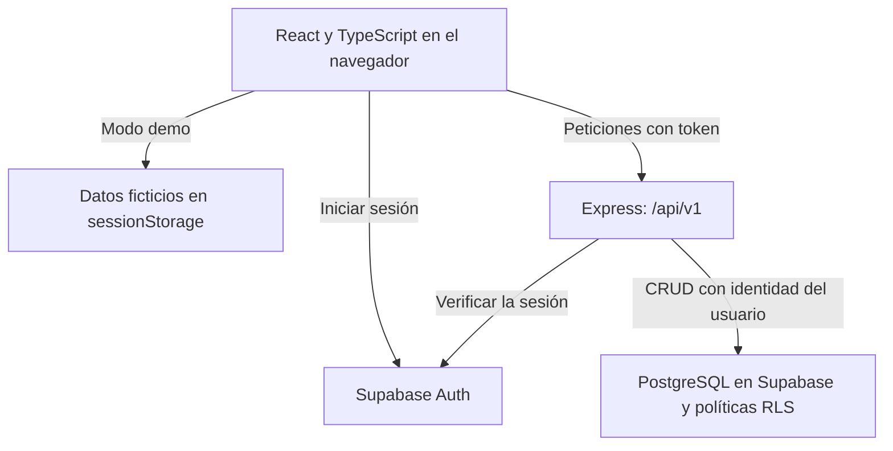

# Gestor DGTN: caso de estudio

[Probar la demo](https://tangerine-panda-3a3a2d.netlify.app/demo) · [Código y guía de instalación](../README.md)

## El problema

Un trabajo de fotografía o video reúne información que necesita seguimiento: fecha del evento, servicio contratado, estado del contrato, cuentas de cobro, pagos, gastos y enlaces de entrega. Consultar esos datos por separado dificulta saber qué queda por cobrar o entregar.

Gestor DGTN reúne esa información en un panel y en el detalle de cada trabajo. El proyecto está orientado a la gestión audiovisual; no procesa cobros ni transferencias bancarias.

## Qué se puede hacer

- Crear, editar y eliminar trabajos y egresos.
- Registrar cuentas de cobro y pagos, y confirmar los pagos pendientes.
- Consultar saldos: los pagos pendientes de confirmación todavía no reducen la deuda.
- Registrar entregas y consultar una fecha guía de seis semanas después del evento.
- Descargar y restaurar respaldos JSON validados.
- Acceder a datos propios con una sesión de usuario y detectar conflictos al guardar desde una vista desactualizada.

La demo pública usa datos ficticios y funciona sin registro. Permite probar la interfaz sin acceder a cuentas privadas.

## Cómo está organizado

En el modo privado, React se ocupa de la interfaz y Supabase Auth del inicio de sesión. La API Express verifica el token de cada petición, valida los datos y consulta PostgreSQL con la identidad de ese usuario. Las políticas RLS también restringen el acceso en la base de datos.

La demo comparte el panel y sus operaciones de interfaz, pero utiliza un almacenamiento independiente por pestaña. No inicializa el cliente privado de Supabase ni llama a la API. Por eso puede probarse incluso si el servicio remoto está pausado.

La interfaz se compila con Vite. En producción, Netlify publica los archivos estáticos y ejecuta Express mediante una función serverless. La API está bajo el mismo origen que la interfaz.

## Decisiones y sus motivos

| Decisión | Motivo | Alcance y límite |
| --- | --- | --- |
| React y TypeScript estricto | Organizar la interfaz y detectar incompatibilidades de tipos antes de compilar. | Las respuestas de red y los respaldos también requieren validación durante la ejecución. |
| API REST propia | Centralizar la autenticación de las peticiones, la validación y las reglas de acceso a los datos. | El inicio de sesión se realiza directamente con Supabase Auth. |
| Filtros por usuario y RLS | Restringir la consulta y modificación de registros al usuario autenticado. | La instalación remota debe conservar sus permisos y políticas; las pruebas locales no certifican esa configuración. |
| Revisiones por registro e If-Match | Evitar que una pestaña sobrescriba un registro que cambió después de leerlo. | Se detecta el conflicto y se detiene el guardado; no se combinan cambios automáticamente. |
| Tablas de trabajos y egresos con JSONB | Mantener el contenido del trabajo y la compatibilidad con los respaldos existentes. | Cuentas y pagos están dentro de cada trabajo; no tienen tablas independientes para informes relacionales. |
| Demo con sessionStorage | Mostrar operaciones reales de la interfaz sin exponer datos privados ni solicitar credenciales. | Sus cambios son locales a la pestaña y no demuestran la persistencia remota. |
| GitHub Actions | Ejecutar lint, pruebas y compilación al subir código. | Para exigir un resultado aprobado antes de fusionar hace falta configurar la protección de la rama. |

## Un ejemplo del control de cambios

Dos pestañas leen el mismo trabajo con revisión `0`. La primera guarda un pago y la base incrementa la revisión a `1`.

Si la segunda intenta guardar usando `If-Match: "0"`, la operación no encuentra una fila con esa revisión y la API responde con un conflicto (`412`). La interfaz detiene las nuevas escrituras y ofrece descargar un respaldo antes de recargar y comparar los datos.

Este mecanismo protege cada registro. No convierte una restauración de varios trabajos y egresos en una transacción única: algunos registros podrían haberse guardado antes de encontrar un conflicto.

## Qué se comprueba

| Capa | Comprobaciones existentes |
| --- | --- |
| Tipos y código | TypeScript revisa frontend y servidor; ESLint revisa el código. |
| API HTTP | Autenticación, aislamiento por usuario, validación, CRUD, paginación y revisiones. Express, el adaptador serverless y el cliente Supabase son reales; se simula el servicio externo. |
| PostgreSQL | Las migraciones se ejecutan en PGlite para comprobar restricciones, permisos, RLS y triggers. Se simulan los componentes de Auth necesarios para las pruebas. |
| Respaldos | Estructura del JSON, importes, fechas, estados, IDs repetidos y compatibilidad con formatos anteriores. |
| Interfaz de la demo | Creación, edición, borrado, recarga, confirmación de pagos y reinicio; sin llamadas a fetch ni cambios en la sesión privada de prueba. |
| Publicación | Comprobaciones manuales de la interfaz, la demo y operaciones autenticadas con datos de prueba. |

Las pruebas automatizadas de interfaz se ejecutan con React Testing Library y jsdom. No son pruebas E2E completas en un navegador ni sustituyen la revisión visual. Los tests de API y SQL tampoco reemplazan una comprobación de la configuración real de Supabase y Netlify.

Los comandos y la configuración de CI se encuentran en la sección [Comprobaciones del README](../README.md#comprobaciones).

## Recorrido para probar el proyecto

1. Abrir la demo, que comienza con tres trabajos ficticios.
2. Entrar al detalle de un trabajo para consultar sus cuentas, pagos y entregas.
3. Crear un trabajo o registrar un egreso y recargar la página para comprobar la persistencia de esa pestaña.
4. Descargar un respaldo para inspeccionar el formato de los datos.
5. Usar «Reiniciar demo» para recuperar los ejemplos.

Este recorrido no requiere correo, contraseña ni acceso a la base de datos privada. Para instalar la aplicación completa se debe seguir la [guía del repositorio](../README.md#desarrollo-local) y la [guía SQL](../supabase/README.md).

## Límites actuales y posibles ampliaciones

- **Colaboración:** cada cuenta administra sus propios registros. No hay equipos con permisos compartidos ni edición colaborativa en tiempo real.
- **Conectividad:** el modo privado necesita acceso a la API y a Supabase. La demo local no es un modo de trabajo sin conexión para las cuentas privadas.
- **Informes SQL:** si se necesitan consultas detalladas de pagos entre muchos trabajos, tendría sentido separar cuentas y pagos en tablas y migrar los datos con respaldo y pruebas.
- **Pruebas E2E:** un flujo automatizado en un navegador contra un entorno de pruebas independiente sería una ampliación de la cobertura actual.
- **Historial y recuperación:** las revisiones detectan conflictos, pero no guardan todas las versiones anteriores de cada registro. Los respaldos JSON se descargan manualmente.
- **Métricas:** no se presentan cifras de ahorro de tiempo, volumen de usuarios ni resultados comerciales porque no se han medido.

Estas ampliaciones deben responder a una necesidad concreta. La versión actual permite demostrar la gestión de trabajos y finanzas, una API autenticada, persistencia en PostgreSQL y comprobaciones automatizadas.
